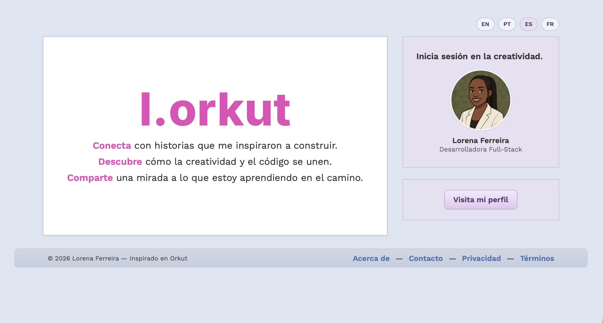
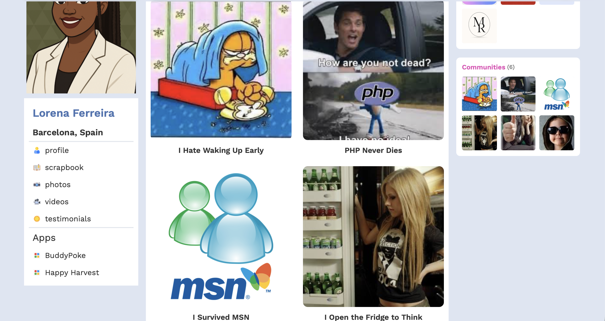

<h1 align="center">
  Lorena Ferreira | Full-Stack Developer Portfolio
</h1>

<p align="center">
  A modern full-stack portfolio showcasing my projects, professional experience, technical skills, and development journey.
</p>

<p align="center">

[](https://react.dev)
[](https://vite.dev)
[](https://developer.mozilla.org/en-US/docs/Web/JavaScript)
[](https://www.java.com)
[](https://spring.io/projects/spring-boot)
[](https://cloudinary.com)
[](https://railway.com)
[](https://vercel.com)
[](https://lorenaferreira.dev)

</p>

---

## Project Overview

This repository contains the latest version of my personal developer portfolio.

The project was built to present my work, experience, technical skills, and professional background through an interactive and responsive web experience.

Unlike a traditional static portfolio, this application includes a React frontend connected to a Spring Boot REST API, allowing project information and media to be managed through a scalable backend architecture.

The portfolio represents my transition from frontend development into full-stack development, combining modern interface design with backend services, cloud deployment, database integration, and media storage.

---

## Live Website

The application is available at:

### [lorenaferreira.dev](https://lorenaferreira.dev)

---

## Screenshots

### Desktop — Home



### Mobile — Home


### Projects


### Communities



---

## Main Features

* Responsive design for desktop, tablet, and mobile devices
* Interactive personal portfolio
* Dynamic project feed
* Full-stack frontend and backend integration
* REST API communication
* Bundled project screenshots and Cloudinary-hosted media
* Backend deployed on Railway
* Frontend deployed on Vercel
* Responsive project cards
* Professional experience timeline
* Technical skills presentation
* External project and repository links
* Contact and social media integration
* Reusable React components
* Environment-based configuration

---

## Tech Stack

### Frontend

* React
* Vite
* JavaScript
* JSX
* CSS3
* Fetch API

### Backend

* Java
* Spring Boot
* Spring Web
* Spring Data JPA
* REST API
* Maven

### Database

* MySQL
* Railway-hosted database

### Media Storage

* Cloudinary

### Deployment

* Vercel — frontend
* Railway — backend and database

### Development Tools

* Git
* GitHub
* Visual Studio Code
* Postman
* Maven Wrapper

---

## Application Architecture

The portfolio follows a full-stack architecture with a clear separation between the frontend, backend, database, and media storage services.

```text
┌──────────────────────────────┐
│       React Frontend         │
│    Vite · JavaScript · CSS   │
│    Deployed on Vercel        │
└──────────────┬───────────────┘
               │
               │ HTTP Requests
               ▼
┌──────────────────────────────┐
│    Spring Boot REST API      │
│      Java · Spring Data      │
│     Deployed on Railway      │
└──────────────┬───────────────┘
               │
               │ JPA
               ▼
┌──────────────────────────────┐
│     MySQL Database      │
│      Hosted on Railway       │
└──────────────────────────────┘

               │
               │ Image URLs
               ▼

┌──────────────────────────────┐
│      Cloudinary Storage      │
│     Project media hosting    │
└──────────────────────────────┘
```

The projects service combines records from the Spring Boot API with the curated entries in `frontend/src/data/portfolioProjects.js`. Curated project pages use localized copy from `frontend/src/i18n/locales/` and bundled screenshots. API-backed records remain available alongside the curated entries. The curated catalog and its detail pages can be opened without MySQL.

---

## Project Structure

### Frontend

```text
src/
├── assets/
├── components/
├── pages/
├── services/
├── styles/
├── App.jsx
└── main.jsx
```

The frontend is organized into reusable components, page sections, service files, and dedicated styles.

### Backend

```text
src/main/java/
└── com/lorkut/backend/
    ├── controller/
    ├── model/
    ├── repository/
    ├── service/
    └── config/
```

The backend follows a layered architecture:

* **Controller:** exposes the REST API endpoints
* **Service:** contains application and business logic
* **Repository:** handles database communication
* **Model:** represents database entities
* **Config:** contains application configuration

---

## API Integration

The frontend retrieves project information from the Spring Boot backend through REST endpoints.

Example request:

```javascript
fetch(`${import.meta.env.VITE_API_BASE_URL}/api/feed`)
  .then((response) => {
    if (!response.ok) {
      throw new Error("Unable to load projects");
    }

    return response.json();
  })
  .then((data) => {
    console.log(data);
  })
  .catch((error) => {
    console.error(error);
  });
```

The production API URL is stored in an environment variable and is not hardcoded into the application.

```env
VITE_API_BASE_URL=https://your-backend-url.up.railway.app
```

---

## Running the Frontend Locally

### 1. Clone the repository

```bash
git clone https://github.com/lorenasferreira/lorenaferreira.dev.git
```

### 2. Open the project directory

```bash
cd lorenaferreira.dev/frontend
```

### 3. Install the dependencies

```bash
npm install
```

### 4. Create the environment file

Create a `.env` file in `frontend/`:

```env
VITE_API_BASE_URL=http://localhost:8080
```

### 5. Start the development server

```bash
npm run dev
```

The frontend will normally be available at:

```text
http://localhost:5173
```

---

## Running the Backend Locally

Start the backend from `backend/` with Java 21 and a local MySQL instance. Load the [local backend environment](#local-backend) before running Maven.

### Using Maven Wrapper

On macOS or Linux:

```bash
./mvnw spring-boot:run
```

On Windows:

```bash
mvnw.cmd spring-boot:run
```

The API will normally be available at:

```text
http://localhost:8080
```

Spring Boot defaults to MySQL on `localhost:8889` and the `lorkut` schema. Override the connection using the backend environment variables below. Create the target MySQL database before startup. Flyway manages its tables, and Hibernate keeps `spring.jpa.hibernate.ddl-auto=none`.

---

## Production Deployment

### Frontend — Vercel

The React application is connected to GitHub and automatically deployed through Vercel.

Every push to the production branch triggers a new deployment.

The frontend environment includes:

```env
VITE_API_BASE_URL=https://your-backend-url.up.railway.app
```

### Backend — Railway

The Spring Boot API is deployed on Railway.

Railway is responsible for:

* Building the Java application
* Running the Spring Boot server
* Managing backend environment variables
* Hosting the MySQL database
* Providing the production API URL

### Images — Cloudinary

Cloudinary hosts media referenced by the application and handles image uploads from the scrapbook. Featured project screenshots are bundled with the frontend.

---

## Environment Variables

### Local backend

Use [`backend/.env.example`](backend/.env.example) as the template for the ignored `backend/.env`. If the local file is missing, copy the template and fill in the MySQL fields and any optional integrations you use. The template leaves `PORT` blank. Set it to the desired local HTTP port or remove the assignment to use Spring Boot's default. Quote shell values containing spaces or special characters, and source only your own trusted local file.

Spring Boot reads exported environment variables. It does not load `.env` automatically. From the repository root, run in zsh or Bash:

```sh
(
  cd backend || exit 1
  set -a
  . ./.env || exit 1
  set +a
  ./mvnw spring-boot:run
)
```

The frontend uses only `VITE_API_BASE_URL` for the backend's public URL. Keep all backend credentials out of frontend variables.

### Railway backend service

| Requirement | Variables |
| --- | --- |
| Required for MySQL | `MYSQLHOST`, `MYSQLPORT`, `MYSQLDATABASE`, `MYSQLUSER`, `MYSQLPASSWORD`. Reference the MySQL service variables in the backend service. |
| Optional HTTP port override | `PORT`. Use the platform-provided value when available and ensure it matches the backend's target port. |
| Optional moderation | `SCRAP_MODERATION_TOKEN`. Required to enable the protected moderation routes. |
| Optional photos | `CLOUDINARY_CLOUD_NAME`, `CLOUDINARY_API_KEY`, `CLOUDINARY_API_SECRET`. Supply all three to enable photo uploads and removal. |
| Optional translation | `DEEPL_API_KEY`. Required to request new translations from DeepL. |
| Temporary for the first authorized startup only | `LORKUT_FLYWAY_BASELINE_ON_MIGRATE=true` only for an existing database without Flyway history, after the schema and target have been checked. Unset it after verifying the baseline and migrations. |

The backend builds its JDBC URL from the separate `MYSQL*` variables. See [Railway MySQL variables](https://docs.railway.com/databases/mysql) and [service references](https://docs.railway.com/variables#reference-variables).

---

## Code Quality

The project was developed with attention to:

* Reusable React components
* Clear separation of concerns
* Responsive-first development
* Organized project structure
* Secure environment configuration
* RESTful API design
* Layered Spring Boot architecture
* Maintainable CSS
* Descriptive variable and component names
* Scalable cloud-based infrastructure

---

## Challenges and Learnings

This project involved more than building the visual interface.

Some of the main technical challenges included:

* Migrating the portfolio to React
* Structuring reusable frontend components
* Building a Spring Boot REST API
* Connecting the frontend to a production backend
* Configuring CORS between Vercel and Railway
* Connecting Spring Boot to MySQL
* Managing environment variables securely
* Deploying a Java backend to Railway
* Integrating Cloudinary for image hosting
* Handling production and local development configurations

These challenges helped strengthen my understanding of full-stack application development and cloud deployment.

---

## Featured Projects

- [BMV Makeup](https://www.bmvmakeup.com/) — multilingual editorial portfolio, filterable gallery and Instagram integration.
- [Portuguese with Thais](https://portuguesewiththais.com/) — lesson booking, a 30-question placement test and a Brazilian culture guide.
- [Marina Rodrigues Photography](https://www.marinarodriiphoto.com/) — multilingual photography portfolio with a Spring Boot API and a client admin area in development.
- [Au Pair na Espanha](https://www.aupairnaespanha.com.br/) — resource platform with a host-family PDF guide and Brevo signup.

## Database migrations

Flyway runs the versioned SQL in [`backend/src/main/resources/db/migration/`](backend/src/main/resources/db/migration/) when Spring Boot starts, using the existing MySQL datasource. Hibernate schema generation stays disabled (`ddl-auto=none`) and Flyway clean is disabled.

- **New database.** Create an empty MySQL 8 database and start the backend with the existing `MYSQL*` settings pointed at it. V1 creates the active backend tables without seed data, then V2 adds the scrap photo identifier and V3 creates the translation cache.
- **Existing database without Flyway history.** Confirm the target connection, take a backup and verify the existing `projects`, `communities`, `activity_feed` and `scraps` tables against V1. Set `LORKUT_FLYWAY_BASELINE_ON_MIGRATE=true` for the first authorized startup only. Flyway records baseline 1, skips the V1 table creation, and applies V2 and V3. It recognizes matching objects left by the older manual SQL and fails if their definitions are incompatible. Resolve any mismatch with a reviewed change before retrying.
- **Subsequent starts.** Unset the baseline flag. Flyway checks the existing history and runs only pending versions. Add future migrations with a new version and preserve the contents of applied files.
- **Production.** Follow the existing-database procedure on Railway only during an approved rollout, after reviewing the target schema and backup. Verify that the existing database account can perform the required DDL. First startup with Flyway will apply the pending migrations.

To verify the result on the intended database:

```sql
SELECT installed_rank, version, description, type, success
FROM flyway_schema_history
ORDER BY installed_rank;

SHOW COLUMNS FROM scraps LIKE 'avatar_public_id';
SHOW CREATE TABLE scrap_translations;
```

## Scrapbook data and moderation

- `POST /api/scraps` accepts multipart fields `author` (1–100 characters), `message` (1–780), `confirmed=true` and optional `photo`. Only approved scraps appear in public GET responses. The confirmation is validated during submission. The application stores no separate consent record.
- MySQL stores the scrap ID, author, message, avatar delivery URL, Cloudinary public ID for new photos, approval status and creation timestamp. The browser receives the public scrap fields and never receives the Cloudinary credentials or the stored public-ID field.
- The backend decodes and re-encodes JPEG/PNG images, checks their MIME against the decoded format, and limits input to 5 MiB and 8 megapixels. It uses a generated Cloudinary identifier and a generic file name. Moderation controls appearance on the site. A Cloudinary delivery URL can be opened by anyone who knows it.
- Configure `CLOUDINARY_CLOUD_NAME`, `CLOUDINARY_API_KEY` and `CLOUDINARY_API_SECRET` only on the backend to enable photo uploads and deletion. Text-only submission works without these settings.
- Flyway creates the optional photo identifier and translation cache during startup. Existing photo URLs and cached translations are preserved.
- Pending list, approval and deletion require the server-only `SCRAP_MODERATION_TOKEN` via an `Authorization: Bearer …` header. When the token is unset, the routes return 404. Use an operator-held random secret over HTTPS. The portfolio has no administrative login, edit endpoint or distinct rejection status.
- For a removal request, use the public list or protected pending list to identify the scrap. After verifying the request, use the protected `DELETE /api/scraps/{id}`. Use the protected `DELETE /api/scraps/{id}/photo` when only the photo should be removed. For a managed photo, deletion requests Cloudinary CDN invalidation before removing the reference from MySQL. Full scrap deletion also removes the database row and translation cache. A provider failure leaves the row for retry. If the database commit fails after Cloudinary removes the file, retry the same ID. The provider’s “not found” response counts as successful removal.
- Legacy submissions with a photo URL and no identifier require manual review. Verify the matching Cloudinary asset and any shared references in the account. After handling the image, the operator can delete the row with `legacyPhotoHandled=true`. The application never infers an asset to delete from a visitor-supplied URL. Failed upload cleanup logs the generated ID for verified manual follow-up.
- The previous frontend used an unsigned Cloudinary preset and a JSON POST. Coordinate a frontend/backend release after the schema change. Review whether any other consumer still uses the unsigned preset before disabling it. No automatic retention schedule is implemented.

## Documentation

- [Roadmap](ROADMAP.md)
- [Project context](docs/PROJECT_CONTEXT.md)
- [Design system](docs/DESIGN_SYSTEM.md)
- [Scrap translation](backend/TRANSLATION.md)

## Author

Designed and developed by **Lorena Ferreira**.

* Portfolio: [lorenaferreira.dev](https://lorenaferreira.dev)
* GitHub: [github.com/lorenasferreira](https://github.com/lorenasferreira)
* LinkedIn: [linkedin.com/in/lorenasferreira/](https://www.linkedin.com/in/lorenasferreira/)

---

<p align="center">
  Built with React, Spring Boot, MySQL, Cloudinary, Vercel, and Railway.
</p>
